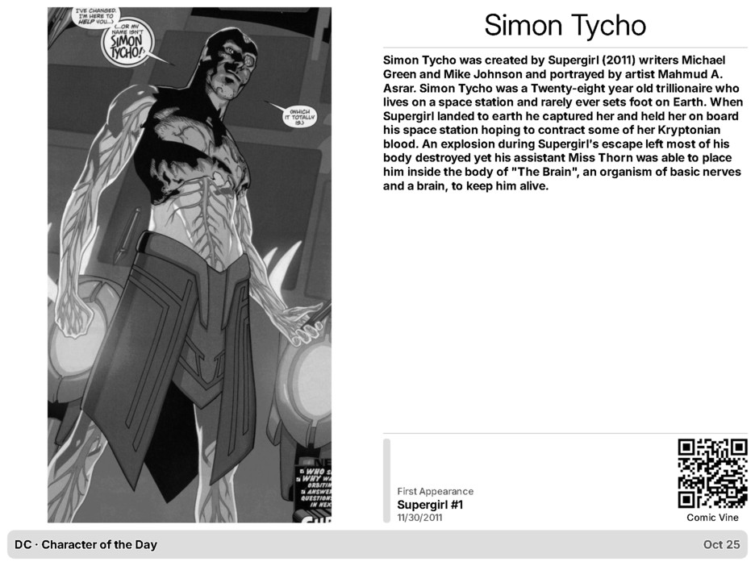

# DC Character of the Day
  

## Adam Grant

Adam was the son of Daily Planet reporter Cat Grant and her ex-husband Joe Morgan. He was then later part of a group of children who were kidnapped by a malfunctioning Toyman robot,during which he attempted to lead the other children in an escape attempt from the villain's lair. However Toyman discovered this and quickly killed Adam.

**First Appearance:** Adventures of Superman #429 (6/30/1987)

[Character Details](https://comicvine.gamespot.com/adam-grant/4005-13707/)

<h2>What is this repository?</h2>
DC Character of the Day is a PowerShell-based application hosted in GitHub that provides information about a different DC character each day. The repository picks a random character daily @ 5am UTC.

<h3>Features</h3>

- <b>Daily DC Character Information:</b> Fetches and displays information about a random DC character every day from ComicVine's API.

- <b>Automated Scripts:</b> Uses PowerShell scripts and GitHub Workflow Actions to automate the process of retrieving and displaying character data.
  
- <b>Friendly JSON Endpoint:</b> Offers an easily retrievable endpoint containing a JSON file with the Daily Character information. You can find this here: https://raw.githubusercontent.com/MarkHopper24/DC-Character-of-the-Day/refs/heads/main/DCCharacterOfTheDay.json
  
- <b>TRMNL Integration:</b> Offers Liquid templates for usage with [TRMNL](https://usetrmnl.com). To use this data for a plugin, you can either:
    1. Create a custom plugin with the polling strategy pointing to the JSON endpoint above. Copy the contents of the files in the .\templates folder to your plugin's markup, and you're done.
    2. Use the companion DC Character of the Day private plugin in TRMNL.

 
(Sample TRMNL screenshot)

<h3>Attribution</h3>
Data provided by Comic Vine https://comicvine.gamespot.com. © 2026 DC Comics
This project and repository has no affiliation with DC.

## Setup

Add your Comic Vine API key as the repository Actions secret [COMICVINEAPIKEY](https://github.com/MarkHopper24/DC-Character-of-the-Day/settings/secrets/actions). Then run **Fetch DC Character Of The Day** from the Actions tab. The workflow runs daily at 05:00 UTC and can also be run manually.

The updater uses Comic Vine publisher ID 10 (DC Comics), keeps the same character JSON fields as the Marvel companion, and adds UpdatedAt and Status for display freshness. character.jpg is the portrait; characterQR.jpg is the Comic Vine character-page QR code. A failed fetch leaves the previously published character unchanged.

The four layout templates mirror the current Marvel plugin markup and use the same TRMNL Framework 3.0.5 version. Clear Shared (templates/shared.liquid is intentionally empty) and copy the matching HTML templates to Full, Half Horizontal, Half Vertical, and Quadrant. templates/settings.yml contains the polling settings.

Companion project: [Marvel Character of the Day](https://github.com/MarkHopper24/Marvel-Character-of-the-Day).
